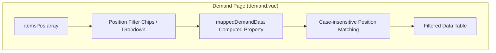

# Replace 'Engineer' with 'intern' on Demand Page Implementation Plan

> **For agentic workers:** REQUIRED SUB-SKILL: Use superpowers:subagent-driven-development to implement this plan task-by-task. Steps use checkbox (`- [ ]`) syntax for tracking.

**Goal:** Replace the `Engineer` position entry with `intern` in [demand.vue](file:///d:/source/aw-recruiting-report/pages/demand.vue) and ensure position filtering handles case-insensitive values (`intern` / `Intern`).

**Architecture:** Update `itemsPos` array in `demand.vue` data function and update the filtering logic in `mappedDemandData` computed property.

**Architecture Diagram:**


**Tech Stack:** Vue.js 2 / Nuxt.js, Vuetify

---

### Task 1: Update itemsPos and position filtering in demand.vue

**Files:**
- Modify: [demand.vue](file:///d:/source/aw-recruiting-report/pages/demand.vue#L586-L640)

- [ ] **Step 1: Replace Engineer with intern in itemsPos array**

In [pages/demand.vue](file:///d:/source/aw-recruiting-report/pages/demand.vue#L586-L594):
```diff
             itemsPos: [
             { vi: 'Tất cả', en: 'All', cn: '所有' },
             { vi: 'Công nhân', en: 'Worker', cn: '工人' },
             { vi: 'Nhân viên', en: 'Staff', cn: '科员' },
             { vi: 'Nhân viên (ngôn ngữ)', en: 'Staff (lang)', cn: '语言科员' },
             { vi: 'Cán bộ', en: 'Leader', cn: '干部' },
             { vi: 'Phiên dịch', en: 'Translator', cn: '翻译' },
-            { vi: 'Kỹ sư', en: 'Engineer', cn: '工程师' }
+            { vi: 'Thực tập sinh', en: 'intern', cn: '实习生' }
             ],
```

- [ ] **Step 2: Update mappedDemandData filtering logic to be case-insensitive**

In [pages/demand.vue](file:///d:/source/aw-recruiting-report/pages/demand.vue#L631-L640):
```diff
             if (this.selectedPositions.length > 0) {
                 if (this.selectedPositions.includes('All')) {
                     this.selectedPositions = ['All'];
-                    
                 } else {
+                    const selectedLower = this.selectedPositions.map(p => String(p).toLowerCase());
                     filteredData = filteredData.filter(item =>
-                    this.selectedPositions.includes(item.dem_position)
+                    item.dem_position && selectedLower.includes(String(item.dem_position).toLowerCase())
                     );
                 }
             }
```

- [ ] **Step 3: Verification**

Check `demand.vue` file syntax and verify that position chips now render `Thực tập sinh` and filter matching database rows.
